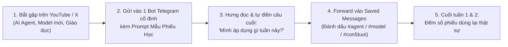

# Hướng dẫn thử nghiệm 2 tuần (16/10 – 30/10/2026) — Học & Đúc kết cùng Bot cá nhân

**Phạm vi:** Chỉ dành cho cá nhân Hưng trong 2 tuần tới.
**Nguyên tắc:** Chưa viết code, chưa đọc chat log Prod, chưa đổi VPS/API/category trên `hungreo.com`, chưa publish công khai. Mục tiêu là kiểm chứng thói quen thực tế trước khi quyết định có cần xây thêm công cụ hay cải tiến nhỏ nào không.

---

## 1. Bức tranh thực tế: Bot hiện có làm được gì & Chưa kiểm gì?

| Hạng mục | Nhãn bằng chứng | Chi tiết |
|---|---|---|
| **Hạ tầng Bot trên VPS** | `PRIOR-EVIDENCE` (từ case study OpenClaw trên Prod & `HANDOVER.md`) | Trên VPS đang có 2 profile OpenClaw chạy `systemd --user` (`@hungreo_openbot` và `@suckhoe_bot`, dùng GPT-5.4 có Claude fallback, kèm overnight research pipeline lúc 01:00 sáng với Perplexity `sonar-pro`). Ngoài ra bạn có đề cập đang dùng thêm `hermes`. |
| **Chat trực tiếp & Tóm tắt qua Telegram** | `PRIOR-EVIDENCE` | Bot Telegram (`@hungreo_openbot` hoặc bot bạn đang dùng hằng ngày) đã nhận được tin nhắn văn bản/link và trả lời tóm tắt, tổng hợp theo yêu cầu trong khung chat. |
| **Tự động bóc transcript YouTube dài / đọc trực tiếp bài X (Twitter) khi chỉ gửi 1 URL trần** | `UNVERIFIED` | Chưa kiểm chứng trong phiên này xem khi gửi 1 link YouTube bất kỳ hoặc link `x.com/...` (vốn hay chặn crawler), bot hiện tại trên VPS có tự lấy được toàn văn (full text/transcript) hay chỉ đọc được tiêu đề/search qua Perplexity. **Cách xử lý trong 2 tuần thử:** Nếu gửi link trần mà bot báo thiếu nội dung, dán kèm đoạn text bài X hoặc tóm tắt/transcript có sẵn. |
| **Ghi nhớ tự động thành kho phiếu học có cấu trúc** | `UNVERIFIED` | Chưa kiểm cơ chế lưu trữ riêng cho phiếu học trên VPS. **Cách xử lý trong 2 tuần thử:** Dùng tính năng **Saved Messages** (hoặc Pin tin nhắn / 1 nhóm Telegram riêng tư của Hưng) để lưu lại các Phiếu học đã duyệt. |

---

## 2. Quy trình thử nghiệm 2 tuần (10–15 phút/lần, 3–4 phiếu/tuần)



1. **Chọn 1 bot duy nhất** bạn thấy tiện tay nhất trên Telegram (ví dụ `@hungreo_openbot` hoặc `hermes`).
2. **Mỗi khi thấy 1 video YouTube hoặc 1 bài X thật sự đáng suy ngẫm**, gửi link (kèm text nếu là bài X ngắn) vào bot cùng **Prompt tạo Phiếu Học** bên dưới.
3. **Rule quan trọng nhất:** Không để AI viết hộ 100%. Dòng cuối cùng (**"Góc nhìn của Hưng / Thử nghiệm nhỏ tuần này"**) phải do chính Hưng chốt bằng 1–2 câu thật trước khi lưu.

---

## 3. Mẫu Phiếu Học chuẩn (Learning Card Template)

### 📋 Mẫu câu nhắc (Prompt) gửi cho Bot Telegram

> Dựa trên nội dung/link này, hãy lập giúp mình **Phiếu Học ngắn gọn** theo đúng 5 mục sau (không viết lan man, không tô vẽ, chỗ nào nguồn không nói rõ thì ghi "Chưa có bằng chứng trong nguồn"):
> 1. **Nguồn & Chủ đề:** `[Tên kênh/tác giả]` — `[Link]` — Phân loại: `#ai-agent` | `#ai-model` | `#giao-duc-con`
> 2. **Ý cốt lõi (tối đa 3 gạch đầu dòng):** Tác giả giải quyết bài toán gì? Cơ chế chính là gì?
> 3. **Điểm cần kiểm chứng / Giới hạn:** Điều gì trong bài chỉ là quảng cáo/hype, hoặc điều kiện nào mới áp dụng được?
> 4. **Gợi ý chuyển hóa (chọn 1 trong 2 theo chủ đề):**
>    - *Nếu là AI Agent / Model:* 1 ý tưởng áp dụng vào công việc AI Product Builder hoặc hệ thống cá nhân.
>    - *Nếu là Giáo dục / Tư duy:* 1 trò chơi hoặc cuộc trò chuyện 10 phút với bé 5 tuổi (không dùng màn hình, hoặc cùng con khám phá có định hướng).
> 5. **Chốt của Hưng (để trống cho mình tự điền):** `...`

---

## 4. Ba ví dụ mẫu hoàn chỉnh (3 Examples)

### Ví dụ 1 — Chủ đề: AI Agent (`#ai-agent`)

```markdown
📌 PHIẾU HỌC #01 — [#ai-agent]
1. Nguồn & Chủ đề:
   - Nguồn: Bài chia sẻ trên X / Video về thiết kế Single-Agent + Deterministic Tools so với Multi-Agent.
   - Phân loại: #ai-agent

2. Ý cốt lõi:
   - Nhiều hệ thống Multi-Agent thất bại trong thực tế vì lỗi truyền ngữ cảnh (context drift) và chi phí token nhân lên ở mỗi bước bàn giao.
   - Một Agent đơn lẻ được cấp các script/tool tất định (shell/Python lọc sẵn dữ liệu đầu vào) cho kết quả ổn định và dễ debug hơn rất nhiều.
   - LLM chỉ nên làm khâu tổng hợp (synthesis) và ra quyết định trên dữ liệu đã làm sạch.

3. Điểm cần kiểm chứng / Giới hạn:
   - Tác giả chưa công bố số liệu benchmark cụ thể về độ trễ khi số lượng tool vượt quá 15 tools.

4. Gợi ý chuyển hóa (cho AI Builder):
   - Khi thiết kế workflow mới trên VPS, luôn tách bước "thu thập + lọc trùng + cắt gọn JSON" bằng script trước khi gọi LLM.

5. Chốt của Hưng (Action tuần này):
   - Giữ đúng nguyên tắc này: tuần này chưa viết thêm agent mới trên web, chỉ dùng đúng 1 bot sẵn có để kiểm tra xem bước lọc thông tin thủ công chỗ nào đang tốn thời gian nhất.
```

---

### Ví dụ 2 — Chủ đề: Model mới (`#ai-model`)

```markdown
📌 PHIẾU HỌC #02 — [#ai-model]
1. Nguồn & Chủ đề:
   - Nguồn: Thông báo phát hành / Review kỹ thuật về dòng model suy luận nhỏ (Small Reasoning / Mini Models).
   - Phân loại: #ai-model

2. Ý cốt lõi:
   - Các model phân khúc mini/nhỏ hiện nay đạt chất lượng tóm tắt tiếng Việt và trích xuất cấu trúc JSON rất sát với model lớn nếu prompt có khung mẫu (schema) rõ ràng.
   - Chi phí trên mỗi 1 triệu token thấp hơn nhiều lần, phù hợp cho tác vụ chạy định kỳ hằng đêm (overnight batch) hoặc trả lời RAG dựa trên ngữ cảnh có sẵn.
   - Tuy nhiên, khả năng tự suy luận đa bước khi thiếu ngữ cảnh vẫn kém hơn model flagship.

3. Điểm cần kiểm chứng / Giới hạn:
   - Điểm benchmark trong bài là tiếng Anh; độ tự nhiên khi viết tiếng Việt cho chủ đề đời sống/giáo dục cần tự test trên dữ liệu thật của mình.

4. Gợi ý chuyển hóa (cho AI Builder):
   - So sánh thử cùng 1 câu hỏi tóm tắt bài học giữa model lớn đang dùng trên bot và model mini để xem chất lượng tiếng Việt có chênh lệch đáng kể không.

5. Chốt của Hưng (Action tuần này):
   - Thử gửi cùng 1 bài dài cho bot tóm tắt, kiểm tra xem bot có bịa thêm ý ngoài bài không trước khi tin dùng cho việc tổng hợp tài liệu.
```

---

### Ví dụ 3 — Chủ đề: Hoạt động Bố Mẹ – Con 5 tuổi thời AI (`#giao-duc-con`)

```markdown
📌 PHIẾU HỌC #03 — [#giao-duc-con]
1. Nguồn & Chủ đề:
   - Nguồn: Video/Bài viết về phát triển tư duy đặt câu hỏi (Curiosity & Critical Thinking) cho trẻ mầm non trong kỷ nguyên AI.
   - Phân loại: #giao-duc-con

2. Ý cốt lõi:
   - Trong thời đại AI trả lời được mọi câu hỏi "Cái gì?" (What) trong 1 giây, kỹ năng quý nhất của trẻ không phải là nhớ nhiều thông tin, mà là **biết tò mò hỏi "Tại sao / Như thế nào?"**, **biết quan sát thật** và **biết diễn đạt cảm xúc của mình**.
   - Với trẻ 5 tuổi, học tốt nhất là qua tương tác trực tiếp với bố mẹ, kể chuyện và chạm vào thế giới thật, không phải ngồi trước màn hình chat với AI.
   - AI chỉ nên là "trợ lý hậu trường" giúp bố mẹ nghĩ ra trò chơi hoặc cách giải thích hiện tượng tự nhiên dễ hiểu theo đúng độ tuổi của con.

3. Điểm cần kiểm chứng / Giới hạn:
   - Mỗi bé 5 tuổi có mức độ tập trung khác nhau (thường chỉ 10–15 phút cho một hoạt động có chủ đích); không áp dụng máy móc như bài giảng.

4. Gợi ý chuyển hóa (Hoạt động Bố Mẹ – Con 15 phút):
   - **Trò chơi "Thám tử Hỏi Ngược" (10 phút tối hoặc khi đi dạo):**
     + Thay vì bố giải thích ngay khi con hỏi *"Sao trời mưa / Sao cái cây mọc được?"*, bố hỏi lại con: *"Theo con đoán thì đám mây đang làm gì nhỉ?"* để con tự tưởng tượng và kể ra giả thuyết của con trước.
     + Trước khi con hỏi, bố chỉ dùng bot Telegram ở hậu trường để xin 2 hình ảnh so sánh thật gần gũi (ví dụ: đám mây giống miếng bọt biển hút đầy nước) để kể tiếp câu chuyện cùng con.

5. Chốt của Hưng (Action cuối tuần này):
   - Thử đúng 1 buổi tối cuối tuần (15 phút): dùng bot gợi ý cách giải thích 1 câu hỏi "Tại sao" mà con vừa hỏi trong tuần, rồi chơi trò "Thám tử đoán thử" với con và ghi lại phản ứng của bé.
```

---

## 5. Tiêu chí đánh giá sau 2 tuần (Ngày 30/10/2026)

Sau 2 tuần (tối thiểu 6–8 phiếu học trong Saved Messages), Hưng và agent cùng nhìn lại **3 con số thật**:

1. **Tần suất thật:** Trong 14 ngày, Hưng tạo được bao nhiêu phiếu? Có ngày nào thấy ngại làm vì thao tác bất tiện không? (Bất tiện ở bước nào: gửi link, bot không đọc được bài X/YouTube, hay bước tìm lại phiếu cũ?)
2. **Giá trị thật cho con 5 tuổi & bản thân:** Có ít nhất **2 hoạt động với con** hoặc **2 quyết định kỹ thuật** thực sự được đem ra làm từ các phiếu đó không?
3. **Quyết định bước tiếp theo (Chỉ chọn 1 cải tiến nhỏ có bằng chứng):**
   - Nếu vướng ở khâu *bot không đọc được transcript YouTube/X* → Chỉ nâng cấp đúng 1 script đọc nguồn cho bot trên VPS.
   - Nếu vướng ở khâu *khó tìm lại / muốn chia sẻ các phiếu `#giao-duc-con` hay nhất lên `hungreo.com`* → Lúc đó mới thiết kế 1 cải tiến nhỏ để đưa các phiếu đã chọn lọc lên website.
   - Nếu quy trình trên Telegram đã đủ mượt và chỉ cần dùng cá nhân → Giữ nguyên trên Telegram, không bày thêm code trên website.
